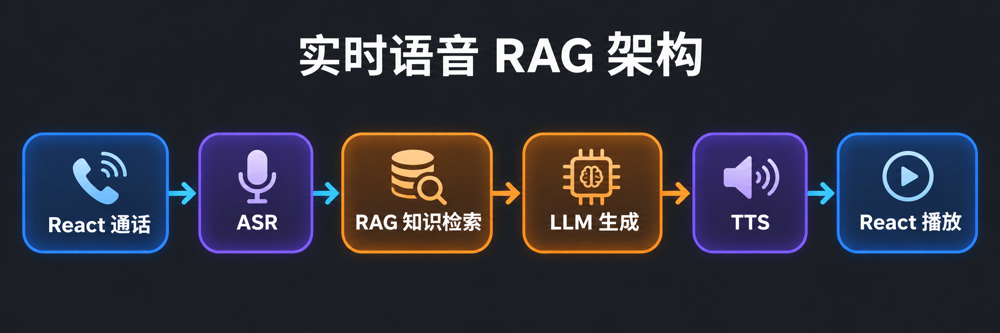

# 实时语音 RAG 客服

**把实时通话与知识问答分成两条链路，React 管交互，自定义后端管检索和回答。**

用户通过浏览器开麦提问，RTC 云端处理语音链路。业务知识集中在独立 RAG 服务，方便替换检索或模型实现。

## 架构怎么跑

| 链路 | 实现 |
|---|---|
| 通话与会话 | React 管理通话界面和设备状态。服务端负责场景配置、会话凭证与云端请求。 |
| 语音识别 | RTC 云端编排 ASR，将识别后的消息交给自定义模型回调。 |
| 知识检索 | `/api/chat_callback` 取最后一条消息进行检索，把返回的知识内容交给模型服务。 |
| 流式回答 | 模型生成结果通过 SSE 返回，RTC 语音链路负责 TTS 和播放。 |

**设计取舍**：RTC 处理音频传输和语音编排，RAG 回调独立部署。换知识库或调整回答逻辑时，改动集中在检索和生成层。

## 一轮语音问答的数据流

1. **建立会话**。React 客户端维护设备、房间和通话状态；场景服务提供会话信息并代理 RTC 云端请求。
2. **从音频到问题**。ASR 在 RTC 链路中运行。云端将识别后形成的消息传给自定义模型回调。
3. **从问题到知识内容**。回调取最新一条消息进行知识检索，检索结果随对话消息交给模型生成服务。知识检索与模型调用分开实现，在排查时可以分别观察取回的内容和生成结果。
4. **从结果到播报**。回调以 SSE 输出生成结果，由语音链路完成 TTS 和播放。浏览器继续管理通话界面和音频设备。

## 接口和排查入口

| 关注点 | 入口 |
|---|---|
| 浏览器如何与 RTC 交互 | [RTC 客户端](src/lib/RtcClient.ts)、[状态管理](src/store/) |
| 房间和场景如何接入 | [Node 场景服务](Server/app.js)、[Python 场景服务](server_python/main.py) |
| RAG 是否取回正确知识 | 在已配置的 RAG 服务上调用 `GET /debug/rag`，查看检索结果。 |
| 模型与检索是否能串通 | `POST /debug/chat` 可直接检查文本链路；`POST /api/chat_callback` 是 RTC 调用的流式入口。接口均在 [RAG 服务入口](rag_llm_server/main.py)。 |

完整通话需要 RTC、ASR、TTS、模型和知识库服务配置。文本调试接口用于单独检查 RAG 链路。

## 源码入口

- [React RTC 客户端](src/lib/RtcClient.ts)
- [场景接入服务](Server/app.js)
- [RAG 回调接口](rag_llm_server/main.py)和[检索及模型服务](rag_llm_server/services/)

## 本地启动

准备 RTC、ASR、TTS 和模型服务配置。将云端生成的场景配置保存为 `Server/scenes/Custom.json`，再按各模块依赖清单安装并启动前端、场景服务与 RAG 后端。

项目基于火山引擎 AIGC-RTC Demo。上游许可见 [LICENSE](LICENSE)。
